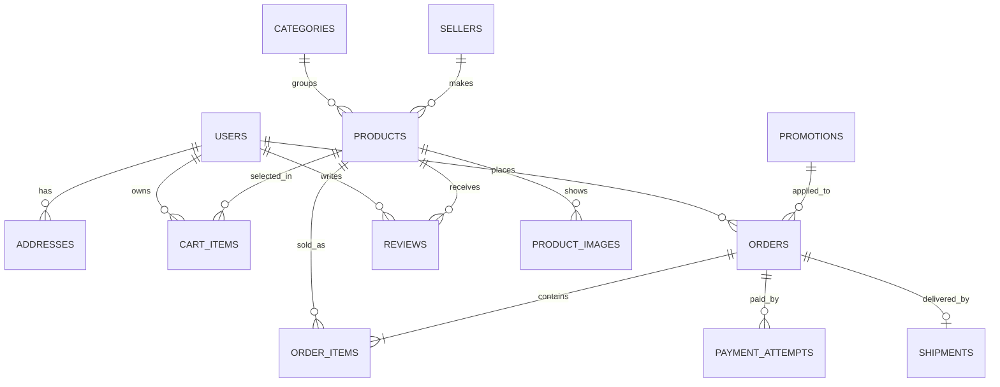

# Cấu trúc dữ liệu Việt Craft

SQL tạo bảng: [001_initial.sql](../database/001_initial.sql). Đây là thiết kế cho bản demo có một admin quản lý catalog. Bảng `sellers` giữ thông tin người làm nghề và là đường mở rộng cho nhiều nhà bán sau này; chưa có tài khoản seller hay đối soát hoa hồng trong MVP.

| Nhóm dữ liệu | Bảng | Vì sao cần |
|---|---|---|
| Tài khoản | `users`, `addresses` | Đăng nhập, phân quyền admin, địa chỉ giao hàng |
| Danh mục | `sellers`, `categories`, `products`, `product_images` | Nguồn gốc làng nghề, tìm/lọc/sắp xếp, nhiều ảnh, giá gốc/giá giảm, tồn kho |
| Giao dịch | `cart_items`, `promotions`, `orders`, `order_items` | Giỏ hàng, mã giảm, đơn hàng, giá tại thời điểm mua |
| Hoàn tất đơn | `payment_attempts`, `shipments` | Tách thanh toán và vận chuyển, lưu mã tham chiếu/đơn vị giao |
| Tương tác | `reviews`, `contact_messages` | Sao/bình luận sản phẩm và form liên hệ/feedback |

## Các quy tắc dữ liệu nhóm phải giữ

- Tiền là số nguyên VND trong cột `bigint`. Frontend chỉ định dạng hiển thị; backend tính giá cuối và tổng đơn.
- `products.price_vnd` là giá gốc. `sale_price_vnd` nhỏ hơn giá gốc; thời hạn giảm giá kiểm tra khi đọc và khi đặt đơn.
- `orders` chứa tổng tiền và thông tin nhận hàng dạng snapshot; `order_items` giữ tên, ảnh, giá, số lượng tại thời điểm đặt. Không tính lại đơn cũ bằng giá hiện tại của sản phẩm.
- `orders.status` mô tả giao hàng; `payment_status` mô tả tiền. Hai trạng thái không được trộn.
- Tạo đơn, trừ tồn và sử dụng khuyến mại trong một transaction. Khóa sản phẩm và mã khuyến mại liên quan để hai người mua cùng lúc không lấy quá tồn/lượt dùng. `idempotency_key` ngăn thao tác đặt đơn lặp.
- Review chỉ xuất hiện công khai khi `status='visible'`. `contact_messages` không có endpoint đọc công khai.
- Xóa sản phẩm đã có đơn nên đổi `status='hidden'` thay vì xóa dòng; khóa ngoại `order_items` giữ lịch sử.
- Trường `updated_at` cần được backend cập nhật trong các lệnh UPDATE hoặc bổ sung trigger; SQL hiện đặt mặc định lúc tạo dòng.

## Mẫu dữ liệu cần tạo trong seed

Tối thiểu bốn danh mục: gốm, mây tre đan, lụa/thổ cẩm, sơn mài. Mỗi danh mục nên có ít nhất ba sản phẩm, nhiều mức giá và một số sản phẩm có giá giảm để thử lọc/sắp xếp. Có ít nhất một sản phẩm hết hàng, một khuyến mại hợp lệ và một mã hết hạn để kiểm thử. Ảnh cần có nguồn rõ ràng hoặc do nhóm tự tạo/chụp; dùng đường dẫn ảnh demo ổn định trên mọi máy.

Tài khoản admin/customer trong seed chỉ để demo local, tạo qua script dùng password hash và mật khẩu được chia riêng cho nhóm. Không đưa thông tin cá nhân thật vào seed hoặc lên Git.
