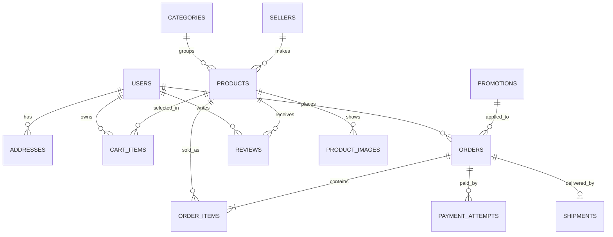

# Cấu trúc dữ liệu Việt Craft

SQL tạo bảng: [001_initial.sql](../database/001_initial.sql). Đây là thiết kế cho bản demo có một admin quản lý catalog. Bảng `sellers` giữ thông tin người làm nghề và là đường mở rộng cho nhiều nhà bán sau này; chưa có tài khoản seller hay đối soát hoa hồng trong MVP.

| Nhóm dữ liệu | Bảng | Vì sao cần |
|---|---|---|
| Tài khoản | `users`, `addresses` | Đăng nhập, phân quyền admin, địa chỉ giao hàng |
| Danh mục | `sellers`, `categories`, `products`, `product_images` | Nguồn gốc làng nghề, tìm/lọc/sắp xếp, nhiều ảnh, giá gốc/giá giảm, tồn kho |
| Giao dịch | `cart_items`, `promotions`, `orders`, `order_items` | Giỏ hàng, mã giảm, đơn hàng, giá tại thời điểm mua |
| Hoàn tất đơn | `payment_attempts`, `shipments` | Tách thanh toán và vận chuyển, lưu mã tham chiếu/đơn vị giao |
| Tương tác | `reviews`, `contact_messages` | Sao/bình luận sản phẩm và form liên hệ/feedback |

## Trạng thái triển khai (cập nhật 30/10/2026)

Schema đã chạy thực tế trên PostgreSQL 16 và được seed dữ liệu demo.

| File | Nội dung | Chạy lặp |
|---|---|---|
| `database/001_initial.sql` | 13 bảng gốc theo thiết kế | Không (chỉ chạy trên DB trống) |
| `database/002_auth_catalog.sql` | Bảng `sessions`; trigger `updated_at`; `immutable_unaccent()` + cột generated `products.search_text`; cột bổ sung cho catalog; unique index địa chỉ mặc định | Có (idempotent) |
| `database/003_product_image_unique.sql` | Unique `(product_id, sort_order)` trên `product_images`, dọn ảnh trùng | Có (idempotent) |
| `database/seeds/001_demo.sql` | 4 danh mục, 12 sản phẩm, ảnh local, 2 tài khoản demo, 2 mã khuyến mại | Có (UUID cố định + `ON CONFLICT`) |

### Bảng bổ sung: `sessions`

| Cột | Kiểu | Ghi chú |
|---|---|---|
| `id` | uuid | khóa chính |
| `user_id` | uuid | FK `users(id) ON DELETE CASCADE` |
| `token_hash` | char(64) | SHA-256 của token trong cookie, unique |
| `user_agent`, `ip` | varchar | thông tin thiết bị để rà soát |
| `created_at`, `expires_at` | timestamptz | hạn phiên mặc định 7 ngày |
| `revoked_at` | timestamptz | đặt khi logout; session còn hiệu lực khi `revoked_at IS NULL AND expires_at > now()` |

### Cột bổ sung trong `products` / `product_images`

Thêm bằng migration 002 để API catalog khớp shape storefront, đều nullable nên không phá dữ liệu cũ:

| Cột | Kiểu | Mục đích |
|---|---|---|
| `products.sku` | varchar(60), unique khi khác null | mã hàng |
| `products.source_name`, `source_url` | varchar/text | nguồn dữ liệu/uy tín sản phẩm |
| `products.collected_at` | timestamptz | thời điểm thu thập dữ liệu nguồn |
| `products.attributes` | jsonb, default `{}` | thuộc tính hiển thị (chất liệu, kích thước) |
| `products.is_demo`, `products.price_is_demo` | boolean | đánh dấu dữ liệu minh họa |
| `products.search_text` | text generated | tên + mô tả + chất liệu đã bỏ dấu, phục vụ tìm không dấu |
| `product_images.source_url` | text | URL ảnh gốc khi ảnh đã cache local |

### Trigger `updated_at`

Hàm `set_updated_at()` được gắn cho `users`, `products`, `orders` để mọi `UPDATE` tự cập nhật thời gian, khắc phục ghi chú cũ "SQL hiện đặt mặc định lúc tạo dòng".

## Các quy tắc dữ liệu nhóm phải giữ

- Tiền là số nguyên VND trong cột `bigint`. Frontend chỉ định dạng hiển thị; backend tính giá cuối và tổng đơn.
- `products.price_vnd` là giá gốc. `sale_price_vnd` nhỏ hơn giá gốc; thời hạn giảm giá kiểm tra khi đọc và khi đặt đơn.
- `orders` chứa tổng tiền và thông tin nhận hàng dạng snapshot; `order_items` giữ tên, ảnh, giá, số lượng tại thời điểm đặt. Không tính lại đơn cũ bằng giá hiện tại của sản phẩm.
- `orders.status` mô tả giao hàng; `payment_status` mô tả tiền. Hai trạng thái không được trộn.
- Tạo đơn, trừ tồn và sử dụng khuyến mại trong một transaction. Khóa sản phẩm và mã khuyến mại liên quan để hai người mua cùng lúc không lấy quá tồn/lượt dùng. `idempotency_key` ngăn thao tác đặt đơn lặp.
- Review chỉ xuất hiện công khai khi `status='visible'`. `contact_messages` không có endpoint đọc công khai.
- Xóa sản phẩm đã có đơn nên đổi `status='hidden'` thay vì xóa dòng; khóa ngoại `order_items` giữ lịch sử.
- Trường `updated_at` cần được backend cập nhật trong các lệnh UPDATE hoặc bổ sung trigger; SQL hiện đặt mặc định lúc tạo dòng.

## Mẫu dữ liệu cần tạo trong seed

Tối thiểu bốn danh mục: gốm, mây tre đan, lụa/thổ cẩm, sơn mài. Mỗi danh mục nên có ít nhất ba sản phẩm, nhiều mức giá và một số sản phẩm có giá giảm để thử lọc/sắp xếp. Có ít nhất một sản phẩm hết hàng, một khuyến mại hợp lệ và một mã hết hạn để kiểm thử. Ảnh cần có nguồn rõ ràng hoặc do nhóm tự tạo/chụp; dùng đường dẫn ảnh demo ổn định trên mọi máy.

Tài khoản admin/customer trong seed chỉ để demo local, tạo qua script dùng password hash và mật khẩu được chia riêng cho nhóm. Không đưa thông tin cá nhân thật vào seed hoặc lên Git.

### Seed hiện có (`database/seeds/001_demo.sql`)

- 4 danh mục: `gom-su` (4 sản phẩm), `may-tre-dan` (3), `tho-cam` (3), `non-la` (2) — tổng 12 sản phẩm.
- Ảnh dùng đường dẫn local `/images/...` đã có trong `frontend/public/`, không phụ thuộc hotlink.
- 1 sản phẩm hết hàng (`binh-gom-nan-tay-2-00639bcf`, `stock_quantity = 0`) để test xử lý hết hàng.
- 2 sản phẩm có giá giảm trong thời hạn để test lọc/sắp xếp theo giá.
- 2 tài khoản demo: `admin@langmoc.local` / `Admin@123` và `customer@langmoc.local` / `Customer@123`. Hash bcrypt cố định, **chỉ dùng local**; phải đổi trước khi triển khai thật.
- 2 mã khuyến mại: `LANGMOC10` (hợp lệ) và `HETHAN` (đã hết hạn) để C4 kiểm thử.

#### Vì sao chưa có danh mục "Sơn mài"

Mục "Mẫu dữ liệu cần tạo trong seed" ở trên ghi bốn nhóm gồm **sơn mài**. Seed hiện tại dùng bốn nhóm **gốm sứ, mây tre đan, thổ cẩm, nón lá** thay vì sơn mài vì:

- Bộ dữ liệu crawl trong `data/catalog/` (Yên Lam, Tiệm Gốm Việt, Maries, Craft Link, Minh Phong, Balothocam) **không có sản phẩm sơn mài** nào.
- Bộ ảnh đã cache trong `frontend/public/images/` cũng không có ảnh sơn mài.
- Không bịa sản phẩm/ảnh chỉ để đủ số lượng danh mục, vì `DATA_MODEL.md` yêu cầu "ảnh cần có nguồn rõ ràng".

Thay vào đó nhóm thứ tư là "Nón lá" với 7 sản phẩm thật từ Maries (seed chọn 2). Khi nhóm có ảnh sơn mài hợp lệ, bổ sung bằng migration/seed mới, **không sửa** `001_demo.sql` đã chia sẻ; chỉ cần thêm danh mục và sản phẩm, API catalog tự nhận vì đọc từ DB.

#### Kiểm chứng phần backend

Minh chứng chạy thật (33 lượt gọi API, kết quả 31 test, schema dump) nằm ở [`docs/evidence/backend/`](evidence/backend/README.md).
